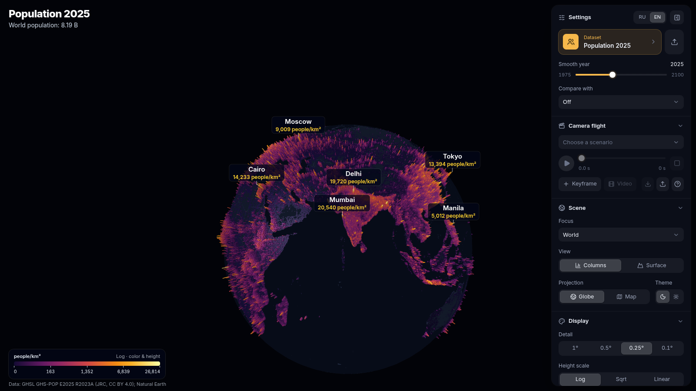
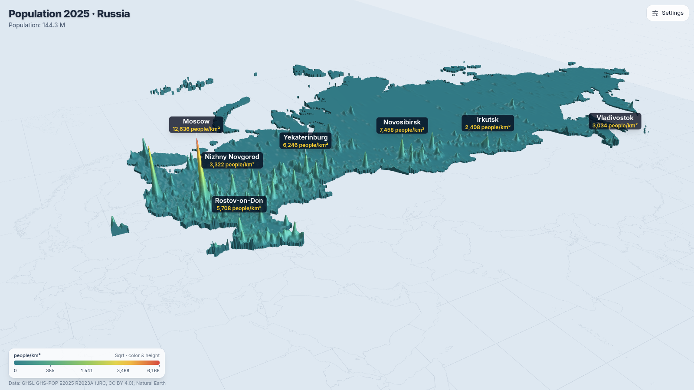
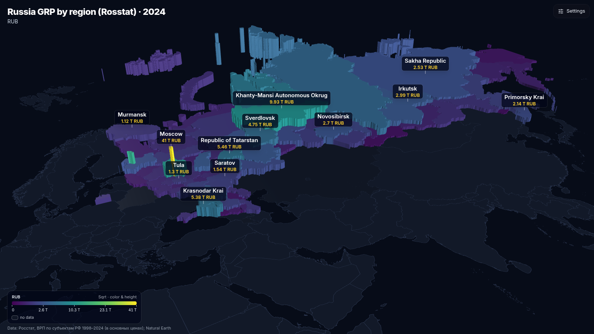
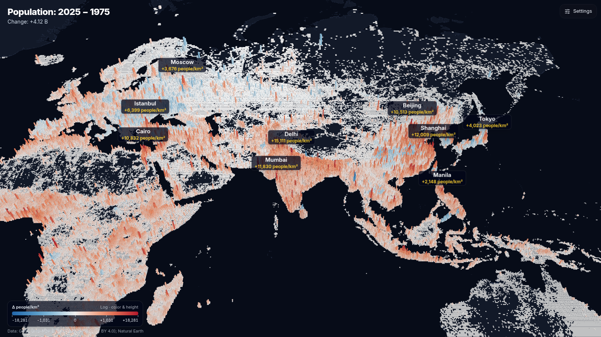
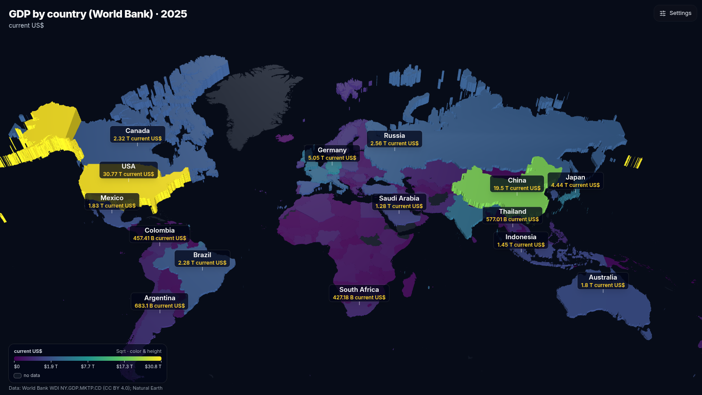
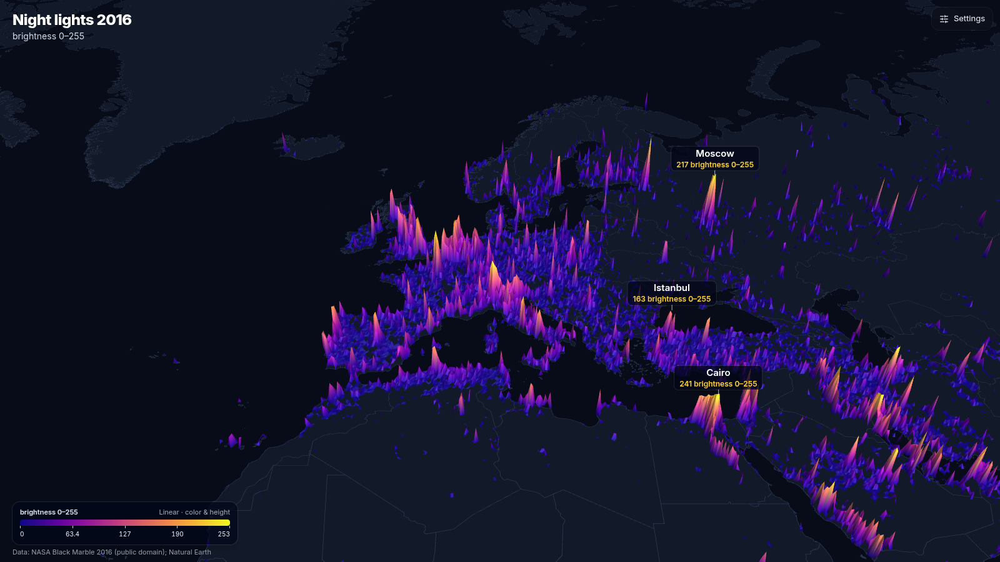
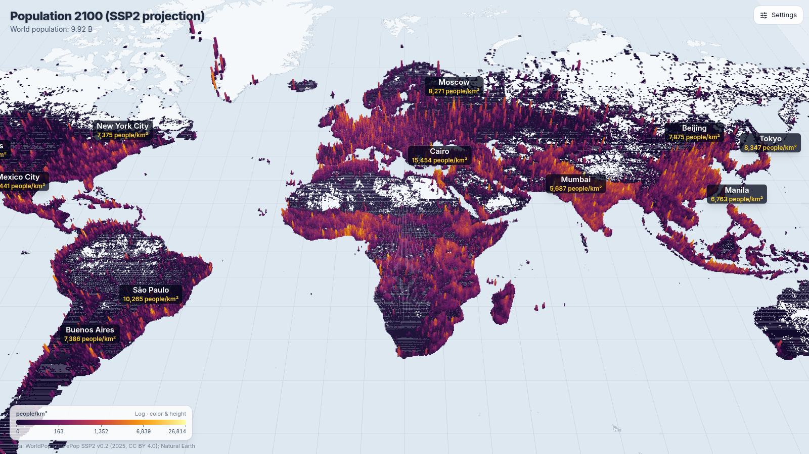
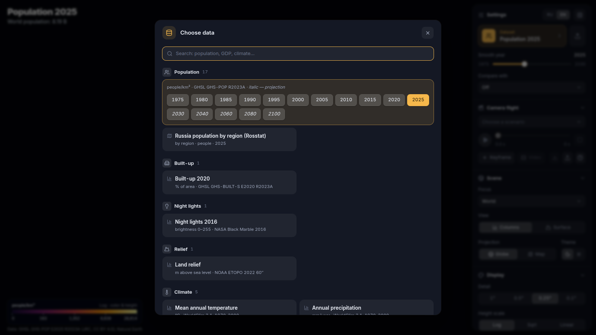
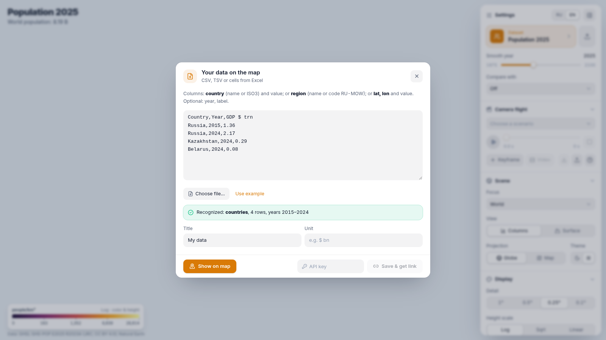

# GeoVis — 3D data visualization on a globe and a map

**[Русский](README.ru.md)** · MIT © 2026 Konstantin Zhebenev

GeoVis shows spatial data in 3D: population density, GDP, terrain, night lights, projections up to 2100, and your
own tables. Data is drawn as columns or as a relief surface on a globe or a flat map, with city and country labels.
The camera flies along a scenario, and the result can be exported to MP4. For embedding into other projects there is
a REST API and an MCP server for AI agents.



## Features

- **3D scenes**:
  - columns (`columns`) or a smoothed surface with walls, like a "slab" (`surface`);
  - globe or flat map, dark and light themes, five palettes;
  - height scale: logarithmic, square root or linear.
- **Built-in datasets** — 28 gridded (6 of them under a restrictive license), 2 by country, 3 by Russian region:
  - population 1975–2030 and projection up to 2100;
  - built-up area, night lights, terrain, shipping lanes;
  - GDP grids, country GDP from the World Bank, gross regional product (GRP) and population of Russian regions (Rosstat).

  The list and licenses are in [DATA_SOURCES.md](DATA_SOURCES.md).
- **Country focus**: Russia and the EAEU countries as a relief "slab" with their own camera angle.
- **Smooth year**: epochs are blended, and columns grow continuously as you move the slider.
- **Difference of two datasets**: for example, population 2025 minus 1975, with a diverging palette.
- **Labels that match the dataset**: cities show the value of their cell, countries show the country average in the
  dataset's units.
- **Camera flight scenarios**: keyframes, smooth arc-shaped flights, scene changes and captions along the way.
  Time is deterministic: the same moment always produces the same frame.
- **Video**: MP4 720p/1080p, plus vertical 9:16 for Shorts, Reels and TikTok. Rendering happens on the server.
- **Your own data**:
  - CSV/TSV or cells pasted from Excel, right on the site;
  - via the API — points, values by country or region, time series, ready-made grids.
- **Embedding and previews**:
  - `<iframe>`, links with view parameters;
  - PNG snapshots for messengers, `og:image` for link previews.
- **MCP**: an agent (Claude and others) creates visualizations on its own and gets back a link, an iframe and an image.
- **Interface**: RU/EN, mobile version (the panel becomes a bottom sheet).

| | |
|---|---|
|  |  |
| "Russia" focus: relief surface | GRP of Russian regions (Rosstat), 3D choropleth |
|  |  |
| Dataset difference: where population grew | Country GDP (World Bank) |
|  |  |
| Night lights 2016, surface | Population projection 2100 (SSP2) |
|  |  |
| Data selection window | Your own data from CSV / Excel |

## Quick start

You need Docker with Compose, Python 3.11+ with [uv](https://docs.astral.sh/uv/), and Node.js 22.

```bash
git clone <url> geovis && cd geovis

# 1. Data: download the original sources and build the grids (slow, needs 20–30 GB during the build)
cd pipeline && uv sync && uv run python prepare.py && cd ..
#    datasets under a restrictive license (WorldClim, IEA-EDGAR CO₂) — only if you are permitted to use them:
#    uv run python prepare.py --include-restricted

# 2. Website
cd web && npm ci && npm run build && cd ..

# 3. Service
cp .env.example .env            # set GEOVIS_ADMIN_KEY (openssl rand -hex 24) and GEOVIS_PUBLIC_URL
docker compose up -d --build
./smoke_test.sh                 # check: page, data, API, MCP, PNG snapshot
```

The site is at http://localhost:8105, Swagger at `/api/docs`, MCP at `/mcp`. Expose it through your own reverse proxy
with TLS; details are in [docs/en/SELF_HOSTING.md](docs/en/SELF_HOSTING.md).

## Documentation

| | |
|---|---|
| [docs/en/ARCHITECTURE.md](docs/en/ARCHITECTURE.md) | how it works: pipeline → web → api → renderer |
| [docs/en/DATA.md](docs/en/DATA.md) | data pipeline, how to add your own dataset or country |
| [docs/en/API.md](docs/en/API.md) | REST API, data contract v1, snapshots, video, MCP |
| [docs/en/SCENARIOS.md](docs/en/SCENARIOS.md) | camera flight scenarios and video recording |
| [docs/en/SELF_HOSTING.md](docs/en/SELF_HOSTING.md) | deployment, configuration, updates, backups |
| [DATA_SOURCES.md](DATA_SOURCES.md) | data sources, licenses, required attributions |

## Tests

```bash
cd pipeline && uv run pytest -q     # "ground truth about the world": world population, Moscow is Russia's peak, GDP ≈ World Bank data…
cd web && npx vitest run            # scales, grids, scenarios, CSV, labels
cd api && uv run pytest -q          # API and MCP for real (JSON-RPC over HTTP)
node web/e2e/scene.e2e.mjs http://localhost:8105            # scene in headless Chrome
node web/e2e/labels-audit.mjs http://localhost:8105         # labels match every dataset
```

The e2e scripts use `puppeteer-core` and the system Chrome (`/usr/bin/google-chrome`).

## License

Code and documentation — [MIT](LICENSE), © 2026 Konstantin Zhebenev. Data downloaded by the pipeline remains under
its publishers' licenses — see [DATA_SOURCES.md](DATA_SOURCES.md).
