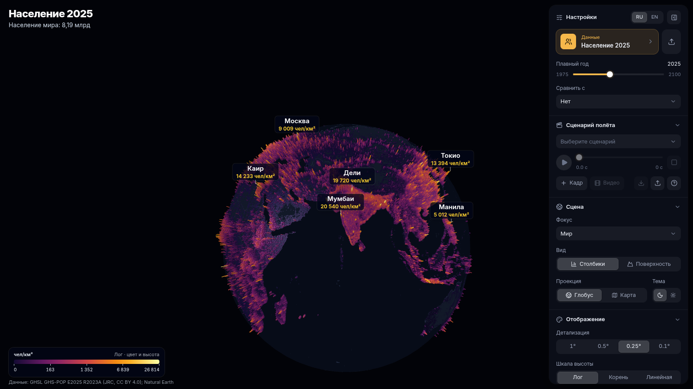
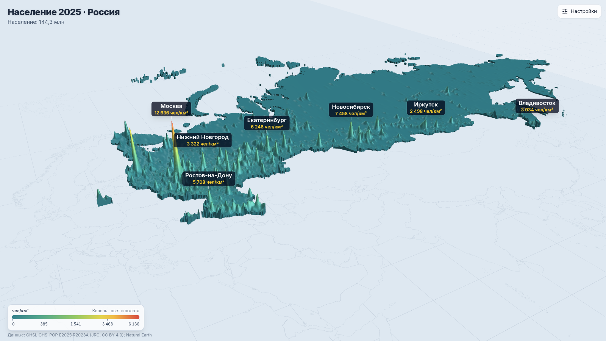
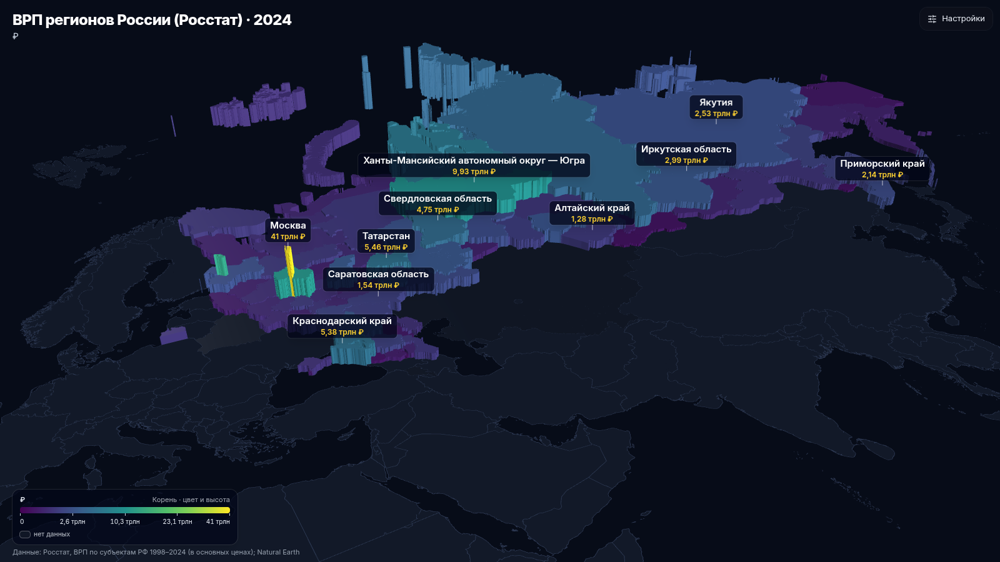
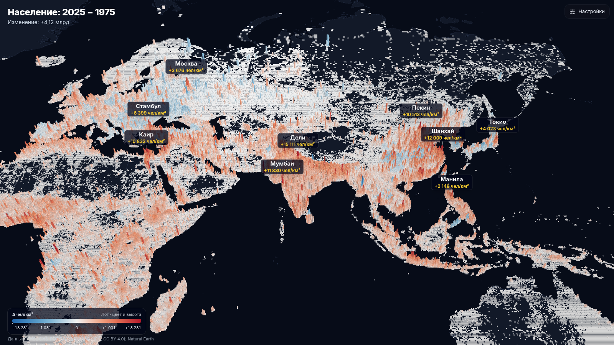
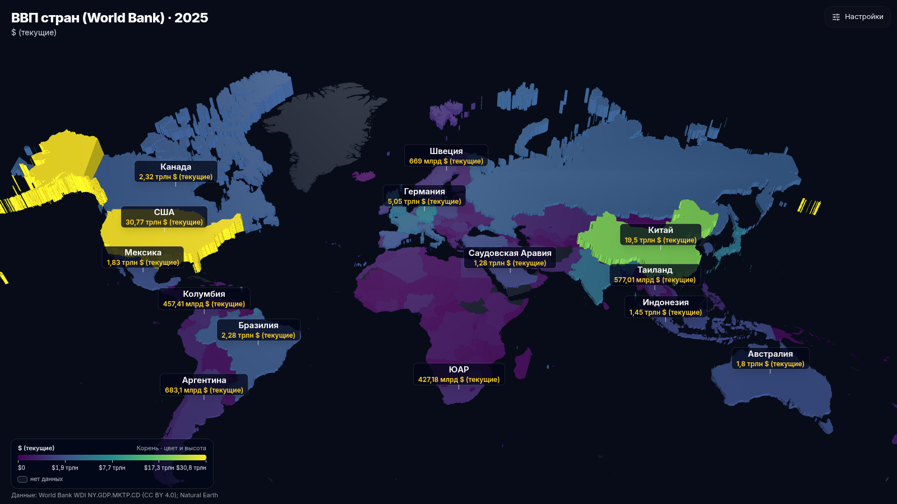
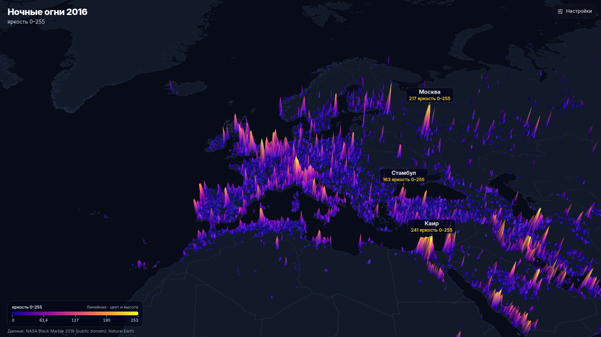
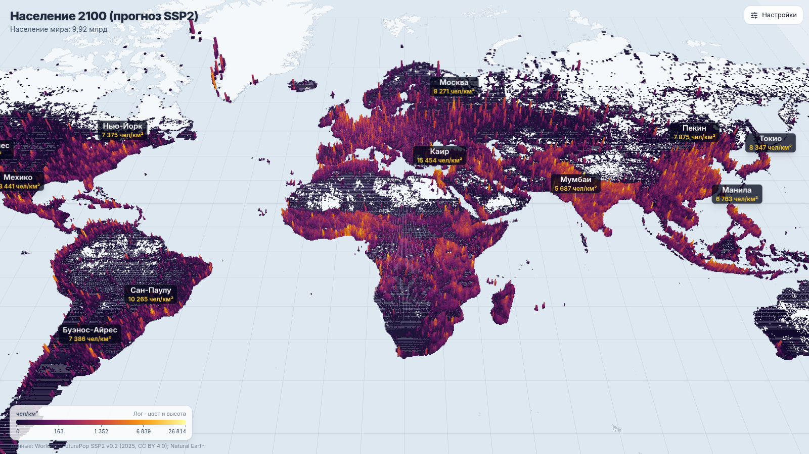
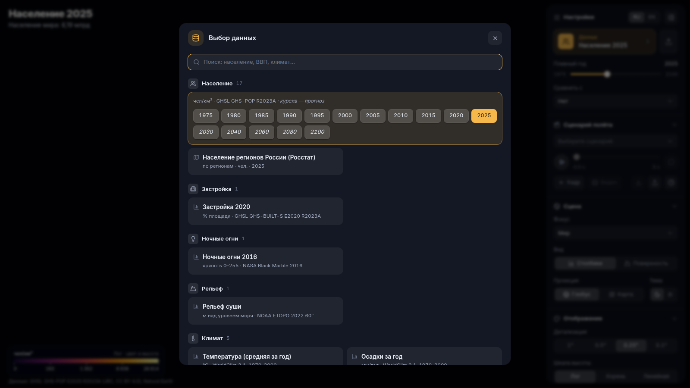
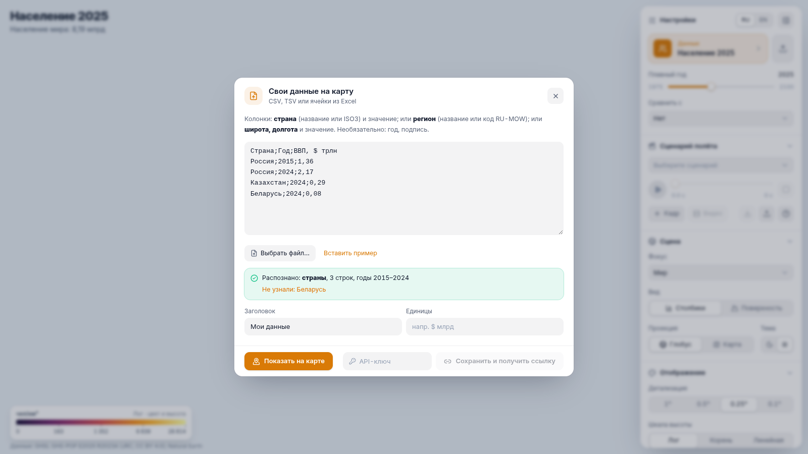

# GeoVis — 3D-визуализация данных на глобусе и карте

**[English](README.md)** · MIT © 2026 Konstantin Zhebenev

GeoVis показывает пространственные данные в 3D: плотность населения, ВВП, рельеф, ночные огни, прогнозы до 2100
года, свои таблицы. Данные рисуются столбиками или рельефной поверхностью на глобусе или плоской карте, с подписями
городов и стран. Камера летит по сценарию, ролик выгружается в MP4. Для встраивания в другие проекты есть
REST API и MCP-сервер для ИИ-агентов.



## Возможности

- **3D-сцены**:
  - столбики (`columns`) или сглаженная поверхность со стенками, как у «плиты» (`surface`);
  - глобус или плоская карта, тёмная и светлая темы, пять палитр;
  - шкала высоты: логарифмическая, корень или линейная.
- **Встроенные наборы** — 28 сеточных (6 из них с ограничительной лицензией), 2 по странам, 3 по регионам России:
  - население 1975–2030 и прогноз до 2100;
  - застройка, ночные огни, рельеф, морские пути;
  - сетки ВВП, ВВП стран по данным Всемирного банка, ВРП и население регионов России (Росстат).

  Список и лицензии — в [DATA_SOURCES.ru.md](DATA_SOURCES.ru.md).
- **Фокус на стране**: Россия и страны ЕАЭС в виде рельефной «плиты» со своим ракурсом.
- **Плавный год**: эпохи смешиваются, на слайдере столбики растут непрерывно.
- **Разница двух наборов**: например, население 2025 минус 1975, с расходящейся палитрой.
- **Подписи по смыслу набора**: у городов — значение в их ячейке, у стран — среднее по стране в единицах набора.
- **Сценарии полёта камеры**: ключевые кадры, плавные перелёты по дуге, смена сцены и титры по ходу.
  Время детерминировано: один и тот же момент всегда даёт один и тот же кадр.
- **Видео**: MP4 720p/1080p, а также вертикальное 9:16 для Shorts, Reels и TikTok. Рендер идёт на сервере.
- **Свои данные**:
  - CSV/TSV или вставка из Excel прямо на сайте;
  - через API — точки, значения по странам или регионам, временные ряды, готовые сетки.
- **Встраивание и превью**:
  - `<iframe>`, ссылки с параметрами вида;
  - PNG-снимки для мессенджеров, `og:image` для превью ссылок.
- **MCP**: агент (Claude и др.) сам создаёт визуализации и получает ссылку, iframe и картинку.
- **Интерфейс**: RU/EN, мобильная версия (панель шторкой снизу).

| | |
|---|---|
|  |  |
| Фокус «Россия»: рельефная поверхность | ВРП регионов (Росстат), 3D-картограмма |
|  |  |
| Разница наборов: где выросло население | ВВП стран (Всемирный банк) |
|  |  |
| Ночные огни 2016, поверхность | Прогноз населения 2100 (SSP2) |
|  |  |
| Окно выбора данных | Свои данные из CSV / Excel |

## Быстрый старт

Нужны Docker с Compose, Python 3.11+ с [uv](https://docs.astral.sh/uv/) и Node.js 22.

```bash
git clone <url> geovis && cd geovis

# 1. Данные: скачать первоисточники и построить сетки (долго, нужно 20–30 ГБ на время сборки)
cd pipeline && uv sync && uv run python prepare.py && cd ..
#    наборы с ограничительной лицензией (WorldClim, IEA-EDGAR CO₂) — только если вам это разрешено:
#    uv run python prepare.py --include-restricted

# 2. Сайт
cd web && npm ci && npm run build && cd ..

# 3. Сервис
cp .env.example .env            # задайте GEOVIS_ADMIN_KEY (openssl rand -hex 24) и GEOVIS_PUBLIC_URL
docker compose up -d --build
./smoke_test.sh                 # проверка: страница, данные, API, MCP, снимок PNG
```

Сайт — http://localhost:8105, Swagger — `/api/docs`, MCP — `/mcp`. Наружу публикуйте через свой reverse proxy с TLS,
подробности — в [docs/ru/SELF_HOSTING.md](docs/ru/SELF_HOSTING.md).

## Документация

| | |
|---|---|
| [docs/ru/ARCHITECTURE.md](docs/ru/ARCHITECTURE.md) | устройство: pipeline → web → api → renderer |
| [docs/ru/DATA.md](docs/ru/DATA.md) | пайплайн данных, как добавить свой набор или страну |
| [docs/ru/API.md](docs/ru/API.md) | REST API, контракт данных v1, снимки, видео, MCP |
| [docs/ru/SCENARIOS.md](docs/ru/SCENARIOS.md) | сценарии полёта камеры и запись видео |
| [docs/ru/SELF_HOSTING.md](docs/ru/SELF_HOSTING.md) | развёртывание, настройки, обновление, резервные копии |
| [DATA_SOURCES.ru.md](DATA_SOURCES.ru.md) | источники данных, лицензии, обязательные ссылки |

## Тесты

```bash
cd pipeline && uv run pytest -q     # «правда о мире»: население Земли, Москва — пик России, ВВП ≈ данным ВБ…
cd web && npx vitest run            # шкалы, сетки, сценарии, CSV, подписи
cd api && uv run pytest -q          # API и MCP по-настоящему (JSON-RPC через HTTP)
node web/e2e/scene.e2e.mjs http://localhost:8105            # сцена в headless Chrome
node web/e2e/labels-audit.mjs http://localhost:8105         # подписи соответствуют каждому набору
```

e2e-сценарии используют `puppeteer-core` и системный Chrome (`/usr/bin/google-chrome`).

## Лицензия

Код и документация — [MIT](LICENSE), © 2026 Konstantin Zhebenev. Данные, которые скачивает пайплайн, остаются
под лицензиями их издателей — см. [DATA_SOURCES.ru.md](DATA_SOURCES.ru.md).
